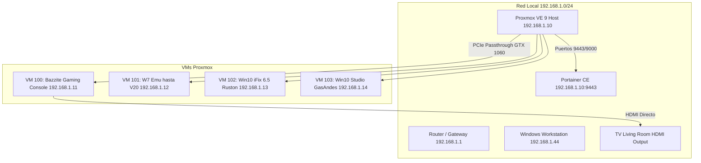

# Proxmox VE Living Room Gaming & Infrastructure Automation

Este repositorio contiene la configuración, infraestructura como código (IaC), scripts de automatización y documentación para transformar el servidor doméstico **Proxmox VE 9** en una consola de juegos estilo **Steam Deck para el living** (usando **Bazzite** con PCIe Passthrough de la **NVIDIA GTX 1060**), migrar máquinas virtuales industriales desde **VMware Workstation**, y gestionar contenedores con **Portainer CE**.

---

## 🚀 Arquitectura General



---

## 📋 Direccionamiento IP y Servicios

| Dispositivo / Servicio | Dirección IP | Puerto / Protocolo | Detalles |
|---|---|---|---|
| **Proxmox VE 9 Host** | `192.168.1.10` | 8006 (HTTPS) / 22 (SSH) | Bridge `vmbr0` estático |
| **Portainer CE** | `192.168.1.10` | 9443 (HTTPS) / 9000 (HTTP) | Docker en host Proxmox |
| **Bazzite Gaming Console** | `192.168.1.11` | Salida HDMI directa a TV | VM 100 con GTX 1060 |
| **W7 Emu hasta V20** | `192.168.1.12` | RDP / Industrial | VM 101 migrada de VMware |
| **Win10 iFix 6.5 Ruston** | `192.168.1.13` | RDP / iFix HMI | VM 102 migrada de VMware |
| **Win10 Studio GasAndes** | `192.168.1.14` | RDP / Studio 5000 | VM 103 migrada de VMware |

---

## 🎮 Bazzite Gaming Console (Living Room)

La máquina virtual **100** ejecuta **Bazzite** (distribución basada en Fedora Silverblue con Steam GamepadUI integrado).

### Características Clave:
- **PCIe Passthrough**: La tarjeta gráfica **NVIDIA GeForce GTX 1060 6GB** (`10de:1b83`) y su controlador de audio HDMI (`10de:10f0`) están aislados del host Proxmox mediante `vfio-pci` y asignados directamente a la VM.
- **Salida de TV**: Al conectar la PC a la televisión del living por HDMI, la señal de video y audio proviene directamente de Bazzite.
- **Controladores NVIDIA**: Drivers propietarios integrados en la imagen oficial `bazzite-deck-nvidia`.
- **Experiencia de Consola**: Interfaz idéntica a Steam Deck optimizada para uso con mandos inalámbricos (Xbox, PlayStation, etc.).

---

## 🔄 Migración de Máquinas Virtuales VMware a Proxmox

El script `scripts/migrate_vms.py` automatiza:
1. Transferencia por red local de los discos VMDK (tanto imágenes monolithic como split multi-extent).
2. Conversión a formato **QCOW2** con aprovisionamiento fino (thin-provisioning).
3. Creación de la máquina virtual KVM correspondiente con preservación de la **dirección MAC original** de VMware para no invalidar licencias industriales (Rockwell Automation / Studio 5000 / GE iFix).
4. Limpieza automática de archivos temporales.

---

## 📁 Estructura del Repositorio

- `scripts/`: Scripts ejecutables para configuración de red, almacenamiento, passthrough, descarga de Bazzite y migración.
- `configs/`: Archivos de configuración de referencia para Proxmox (`interfaces`, `vfio.conf`, `storage.cfg`, etc.).
- `docs/`: Documentación detallada de la consola gaming y el plan de red.

---

## 🛠️ Replicación y Despliegue

```bash
# 1. Configurar red estática
sudo bash scripts/setup_network.sh

# 2. Configurar almacenamiento secundario
sudo bash scripts/setup_storage.sh

# 3. Configurar VFIO y GPU Passthrough
sudo bash scripts/setup_vfio_passthrough.sh

# 4. Desplegar Portainer CE
sudo bash scripts/deploy_portainer.sh

# 5. Descargar imagen de Bazzite y crear VM
sudo bash scripts/download_bazzite_iso.sh
sudo bash scripts/create_bazzite_vm.sh

# 6. Ejecutar migraciones de VMs
sudo python3 scripts/migrate_vms.py 101
sudo python3 scripts/migrate_vms.py 102
sudo python3 scripts/migrate_vms.py 103
```
